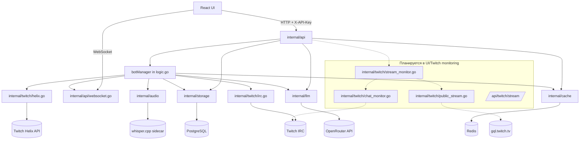
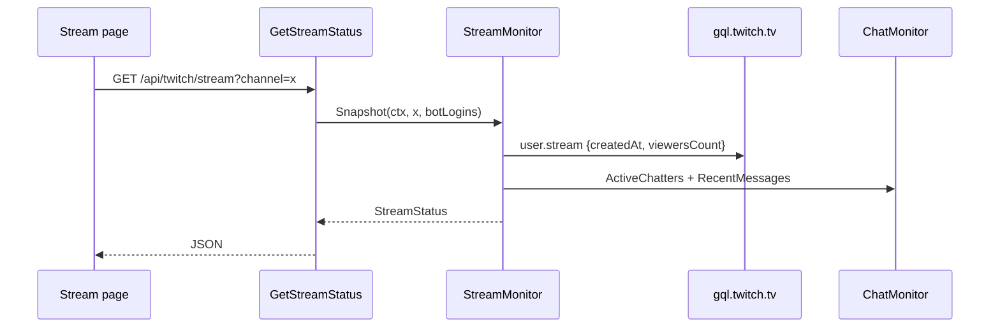

# Code Graph — Twitch SMM

Дата: 2026-11-09
Назначение: быстрый вход для ИИ-агентов. Читай этот файл перед изменением кода,
затем открывай только нужные узлы. Машиночитаемая версия: `docs/code-graph.json`.

## 1. Как пользоваться

1. Найди задачу в таблице «Куда идти».
2. Открой указанный файл и его `Interfaces`/типы.
3. Проверь инварианты в разделе 8.
4. После изменения запусти команды из раздела 9.
5. Не читай весь `logic.go` и не переписывай `Settings.tsx` целиком, если задача
   локальная; в этом графе указаны ответственные узлы.

## 2. Верхнеуровневый граф



## 3. Backend-модули

| Узел | Путь | Ответственность | Ключевые символы |
|---|---|---|---|
| Entrypoint | `logic.go` | env, wiring, bot runtime, менеджер, консоль | `main`, `botManager`, `botRuntime`, `startBot`, `stopBot`, `runBotLoop`, `ApplySettings` |
| API | `internal/api` | REST, WebSocket, auth, handlers, DTO | `NewServer`, `NewHandler`, `Handler`, `BotManager`, `BotDTO`, `StatsDTO`, `Hub` |
| Storage | `internal/storage` | PostgreSQL, схема, настройки, логи, боты | `Store`, `EnsureSchema`, `EnsureSettingsTable`, `Settings`, `BotConfig` |
| LLM | `internal/llm` | OpenRouter, free-first + paid fallback, ключи, статус | `Config`, `EnvConfig`, `DBConfig`, `ResolveConfig`, `Client`, `Reconfigure`, `Status` |
| Twitch IRC | `internal/twitch/irc.go` | исходящие сообщения, reconnect, rate limit | `IRCClient`, `Connect`, `SendMessage`, `readLoop` |
| Twitch Helix | `internal/twitch/helix.go` | опциональные Client ID/Secret, stream info, validation | `HelixClient`, `GetStreamInfo`, `ValidateAccount` |
| Cache | `internal/cache` | Redis: логи, лимиты, статистика | `Client`, `GetBotLogs`, `AddBotLog`, `IncrementBotStats` |
| Audio | `internal/audio` | streamlink + ffmpeg + whisper.cpp STT | `Service`, `Config`, `transcribe` |
| Auth | `internal/auth` | bcrypt-пароли ботов | `HashPassword`, `CheckPassword` |
| Migrations | `internal/migrations` | применение SQL-миграций | `Migrator` |

### Планируемые backend-узлы (см. план UI/Twitch)

| Узел | Путь | Ответственность |
|---|---|---|
| Public GQL | `internal/twitch/public_stream.go` | uptime/viewers без Twitch Dev App |
| Chat monitor | `internal/twitch/chat_monitor.go` | анонимный read-only IRC, active chatters, recent messages |
| Stream monitor | `internal/twitch/stream_monitor.go` | объединение GQL + IRC, `StreamStatus` |
| Presence | `logic.go` | сессии online/cooldown, greeting/farewell |

## 4. API-маршруты

Все `/api/*`, кроме `/api/ws`, требуют `X-API-Key` (или `api_key` query).

| Метод | Путь | Handler | Назначение |
|---|---|---|---|
| GET | `/api/health` | `HealthCheck` | postgres/redis/llm статус |
| GET | `/api/ws` | `Hub.ServeWS` | WebSocket событий |
| GET | `/api/bots` | `ListBots` | список ботов + статус |
| POST | `/api/bots` | `CreateBot` | создать бота |
| GET | `/api/bots/{id}` | `GetBot` | один бот |
| PUT | `/api/bots/{id}` | `UpdateBot` | обновить бота |
| DELETE | `/api/bots/{id}` | `DeleteBot` | удалить бота |
| POST | `/api/bots/{id}/start` | `StartBot` | запустить |
| POST | `/api/bots/{id}/stop` | `StopBot` | остановить |
| GET | `/api/bots/{id}/logs` | `GetBotLogs` | логи бота |
| POST | `/api/bots/start-all` | `StartAll` | запустить всех |
| POST | `/api/bots/stop-all` | `StopAll` | остановить всех |
| GET | `/api/stats` | `GetStats` | total/running/messages_per_min |
| GET | `/api/proxies` | `ListProxies` | прокси |
| POST | `/api/proxies` | `CreateProxy` | добавить прокси |
| DELETE | `/api/proxies/{id}` | `DeleteProxy` | удалить прокси |
| GET | `/api/settings` | `GetSettings` | настройки, `llm_api_key` и `twitch_client_secret` замаскированы |
| POST | `/api/settings` | `UpdateSettings` | полная замена строки настроек |
| GET | `/api/settings/logs` | `GetSettingsLogs` | журнал настроек |
| GET | `/api/settings/test-audio` | `TestAudio` | тест аудио |
| POST | `/api/settings/test-llm` | `TestLLM` | тест LLM |
| GET | `/api/llm/status` | `GetLLMStatus` | OpenRouter статус/бюджет |
| GET | `/api/twitch/stream` | planned | uptime/viewers/chat/player data |
| GET | `/api/twitch/stream` | `GetStreamStatus` (planned) | канал + статус |

## 5. Потоки

### 5.1 Запуск бота и сообщение

```mermaid
sequenceDiagram
    participant UI as React
    participant API as api.StartBot
    participant M as botManager.startBot
    participant IRC as IRCClient
    participant Loop as runBotLoop
    participant LLM as OpenRouter
    participant Hub as WebSocket Hub
    UI->>API: POST /api/bots/{id}/start
    API->>M: startBot
    M->>IRC: Connect()
    M->>Loop: go runBotLoop(ctx, br)
    Loop->>LLM: Generate()
    LLM-->>Loop: text
    Loop->>IRC: SendMessage()
    Loop->>Hub: bot_message_sent
```

### 5.2 Сохранение настроек

`POST /api/settings` → `UpdateSettings` (полная замена) → `ApplySettings` →
`llm.Reconfigure` + каналы + audio + (planned) streamMonitor/presence.
Ключ: пустой входящий `llm_api_key` или `twitch_client_secret` сохраняет
старое значение; ответ всегда маскирует оба (`*_set` сообщает наличие).

### 5.3 Планируемый Stream



### 5.4 Presence (planned)

`startBot` → session timer → `pauseBot` (farewell, cooldown timer) →
`startBot` снова. `StopBot`/error stop отменяют возврат.
Presence не влияет на `viewer_count`.

## 6. Frontend-граф

```
App.tsx
├── layout/Sidebar
├── layout/Topbar
├── pages/Dashboard   -> stats + bots + StreamCard
├── pages/Stream      -> player + metrics + ChatFeed
├── pages/Bots        -> BotsTable + BotModal + BotLogsDrawer
└── pages/Settings    -> channels, Twitch, OpenRouter, audio, behavior, presence
```

| Узел | Путь | Ответственность |
|---|---|---|
| App shell | `frontend/src/App.tsx` | страницы, WebSocketProvider, ErrorBoundary |
| API client | `frontend/src/api/client.ts` | axios, типы, X-API-Key |
| WebSocket | `frontend/src/hooks/useWebSocket.ts` | одно соединение, reconnect, logStore |
| Bot form | `frontend/src/hooks/useBotForm.ts` | валидация формы бота |
| Log store | `frontend/src/stores/logStore.ts` | bot logs, settings logs, presence events |
| Pages | `frontend/src/pages/*` | Dashboard, Stream, Bots, Settings |
| UI kit | `frontend/src/components/ui/*` | Card/Button/Input/Modal/Badge/Alert |

Старые визуальные компоненты (PixelSnow, TargetCursor, Dock, BGPattern,
GooeyNav, TiltCard, FloatingProviderStatus, StatusBar) удалены.

## 7. Данные

| Таблица | Владелец | Важное |
|---|---|---|
| `settings` | `internal/storage/settings.go` | одна строка `id='default'`; JSONB channels; LLM + presence поля |
| `bots` | `internal/storage/postgres.go` | constraints: delay > 0, max >= min, rate > 0 |
| `bot_logs` | `internal/storage/logs.go` | очистка раз в час |
| `settings_logs` | `internal/storage/logs.go` | журнал изменений |
| `proxies` | `internal/storage/postgres.go` | proxy pool |

## 8. Инварианты и мины

1. **`runBotLoop` должен запускаться из `startBot`.** Вызов есть
   (`logic.go`: `go bm.runBotLoop(ctx, br)`), боты генерируют и отправляют.
   Не удаляй этот запуск: без него бот подключается, но молчит.
2. **`stopBot` ждёт цикл только если он работал.** Ожидание `br.stopped`
   возможно лишь при `wasRunning`; бот, который никогда не запускался,
   останавливается сразу, без 10-секундного graceful wait.
3. **`IRCClient.WaitForRateLimit` не держит `c.mu` во время сна.** Бэкофф
   может достигать 5 минут, и `Close`, `IsRateLimited` и `SendMessage` обязаны
   оставаться отзывчивыми всё это время. Сон должен быть между `Unlock`
   после чтения `rateLimitUntil` и повторным `Lock`: не переноси `time.Sleep`
   под залок и не оборачивай его в `defer c.mu.Unlock()`.
4. **`StopBot` не должен авто-возвращать бота.** Авто-возврат только из
   presence cooldown. Error stop — без возврата.
5. **Ключи и токены:** `llm_api_key` никогда не возвращается; OAuth-токены
   ботов не логируются и не показываются после сохранения.
6. **`twitch_client_secret` — только на запись.** `GET /api/settings`
   возвращает пустое значение и `twitch_client_secret_set` (есть секрет или
   нет). Пустой входящий секрет при сохранении сохраняет хранимый — не
   «очищай» его и не начинай отдавать значение наружу.
7. **`openrouter/free` — роутер.** Не сравнивай ответ `model` с этой строкой;
   paid определяется через `usage.cost` или `model == paidModel`.
8. **Настройки — полная замена.** `POST /api/settings` перезаписывает всю
   строку; не отправляй частичный JSON.
9. **`messages_per_min` считает только генерацию.** В статистику попадают
   лишь успешные отправки из цикла генерации; greeting/farewell-фразы
   presence не должны увеличивать счётчик.
10. **Ротация удаляется.** `rotation_*` остаются в БД, но не используются.
11. **Twitch GQL неофициальный.** Ошибки не должны ронять приложение; UI
    показывает «нет данных».
12. **Присутствие не накручивает зрителей.** Только IRC + сообщения.
13. **Тесты storage интеграционные.** Нужен Postgres; без него часть тестов
    падает на connect, а не skip.

## 9. Команды

```bash
go build ./...
go test ./...
cd frontend && npm.cmd run build
docker compose up -d --build --wait
docker compose ps
```

Проверка API:

```powershell
$h=@{'X-API-Key'='secret-api-key-12345'}
Invoke-RestMethod -Headers $h http://localhost:8080/api/health
Invoke-RestMethod -Headers $h http://localhost:8080/api/settings
Invoke-RestMethod -Headers $h http://localhost:8080/api/llm/status
```

## 10. Куда идти с задачей

| Задача | Начать здесь |
|---|---|
| Новый API endpoint | `internal/api/server.go` → `handlers.go` → `dto.go` |
| Логика бота/сообщений | `logic.go`: `startBot`, `stopBot`, `runBotLoop`, `generateMessage` |
| Настройки/миграция | `internal/storage/settings.go` |
| OpenRouter | `internal/llm/config.go`, `internal/llm/openrouter.go` |
| IRC/чат | `internal/twitch/irc.go` (+ planned `chat_monitor.go`) |
| Twitch stream | planned `internal/twitch/public_stream.go`, `stream_monitor.go` |
| UI shell | `frontend/src/App.tsx`, `frontend/src/styles/app.css` |
| Страницы | `frontend/src/pages/*` |
| Боты UI | `frontend/src/pages/Bots.tsx`, `components/BotsTable.tsx`, `BotModal.tsx` |
| Настройки UI | `frontend/src/pages/Settings.tsx` |

## 11. Документы

- Дизайн UI/Twitch: `docs/superpowers/specs/2026-11-09-ui-simplification-twitch-monitoring-design.md`
- План: `docs/superpowers/plans/2026-11-09-ui-simplification-twitch-monitoring.md`
- OpenRouter/STT: `docs/superpowers/specs/2026-11-09-openrouter-whispercpp-design.md`
- Аудио: `docs/AUDIO_TRANSCRIPTION.md`
